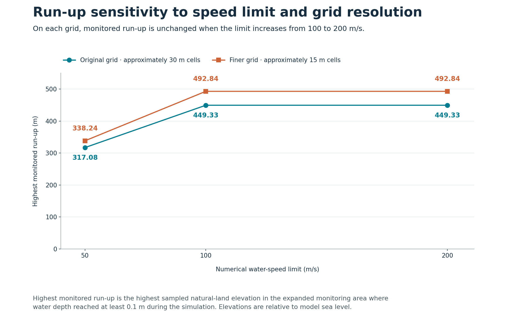
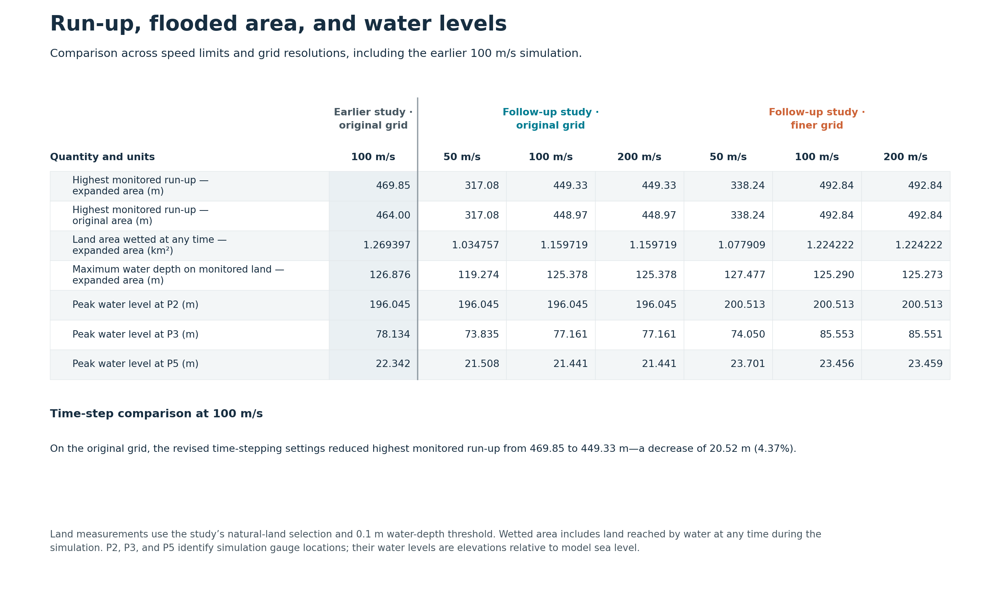

# Lituya Bay simulation

A numerical investigation of the 1958 Lituya Bay megatsunami using GeoClaw, focusing on landslide-generated wave propagation, run-up estimation, and numerical sensitivity.

The repository contains a moving-bed source model, simulation configurations, validation procedures, software tests, and results from a controlled comparison of water-speed limits (50, 100, and 200 m/s).

This preliminary release documents the modeling approach, experimental results, and identified numerical limitations. Further validation and sensitivity analysis are needed to assess historical accuracy and numerical convergence.

## Research objectives

This project investigates the numerical behavior of a simplified model of the 1958 Lituya Bay megatsunami, with particular attention to wave propagation, run-up estimation, and numerical sensitivity.

The study examines how different water-speed limits (50, 100, and 200 m/s) affect simulated run-up and numerical stability. It also considers how measurement criteria and monitoring boundaries influence the interpretation of results.

The objective is to identify the model’s numerical limitations and establish a basis for further validation and refinement.

## Recorded experiment

The completed session is `20261019T041033Z_ff1b17c2`; each case reached 420 s.
The cap is a numerical water-speed limit, not the landslide velocity.

| Water-speed cap (m/s) | Expanded-monitor run-up (m) | Recorded outcome |
| --- | ---: | --- |
| 50 | 339.72425 | Passed basic checks |
| 100 | 469.84918 | Passed basic checks |
| 200 | Unavailable | Failed CFL/time-step checks |

See the [CSV](experiments/2026-10-19-speed-caps/results.csv),
[detailed diagnostics](experiments/2026-10-19-speed-caps/results.json), and
[record description](experiments/2026-10-19-speed-caps/README.md).
The 50 and 100 m/s configurations completed the 420-second simulation period and passed the recorded basic validation checks. Measured run-up increased from 339.72 m to 469.85 m, a difference of approximately 38.3%.

This difference indicates substantial sensitivity to the selected numerical water-speed limit within the tested configurations. The 200 m/s configuration encountered CFL/time-step stability issues and is excluded from the accepted run-up comparison.

Run-up was measured as the maximum eligible ground elevation reached by water at a minimum depth of 0.1 m within the defined monitoring area. These values are specific to that measurement procedure and have not been established as domain-wide maxima.

The results demonstrate numerical sensitivity but do not, by themselves, establish historical accuracy or numerical convergence.

## Simulation visualizations

The figures and animation present saved outputs from session `20261019T041033Z_ff1b17c2`, covering a 420 s simulation period. The figures compare the 50 and 100 m/s numerical water-speed limits, while the animation shows the 100 m/s configuration. Together, they illustrate simulated wave evolution, inundation, and monitored run-up. These are simulation results, not historical observations.

**Wave evolution.** The maps show water-surface elevation relative to model sea level at six recorded times: 20, 46, 80, 160, 300, and 420 s. The two rows compare the 50 and 100 m/s configurations using a shared symmetric-log color scale.


**Animated wave evolution.** The animation shows simulated water-surface elevation for the 100 m/s configuration over 0–420 s. It uses all 49 saved frames, displayed at 25× speed with timing proportional to their recorded timestamps and no interpolation between frames.


**Inundation and run-up.** The maps show the maximum simulated water depth on eligible natural land within the expanded monitoring area. Here, water depth is the vertical distance from the local ground surface to the water surface. Each location represents its maximum over the simulation period. Contours show ground elevation, and stars identify the highest monitored run-up in each configuration. These run-up values have not been verified as bay-wide maxima.


**Numerical sensitivity.** Monitored run-up is 339.72 m for the 50 m/s configuration and 469.85 m for the 100 m/s configuration. This difference demonstrates sensitivity to the numerical water-speed limit within the tested configurations. The 200 m/s configuration is excluded because it failed the recorded CFL/time-step checks.


The maps use local model coordinates. Masking artificial cells in the figures does not remove their influence on the simulation. The results do not establish historical accuracy or numerical convergence.

The [figure provenance](docs/figures/figure_provenance.json) records full-precision measurements, settings, source hashes and rendering details. The [plotting script](experiments/2026-10-19-speed-caps/plot_figures.py) checks the saved data before generating the figures. Regeneration requires the original local simulation session; raw simulation fields and reference inputs are not included in this repository.

## Follow-up analysis: measurement robustness and numerical sensitivity

The [measurement-robustness analysis](analysis/measurement_robustness/report.html) examined how monitoring coverage and the wet-depth threshold affect the earlier run-up measurements. The follow-up experiment then compared 50, 100, and 200 m/s numerical water-speed limits on approximately 30 m and 15 m grids, using the same physical setup and matched time-stepping settings across the six new simulations.

The large 50→100 m/s increase in highest monitored run-up persists on both grids. Increasing the limit to 200 m/s leaves this measure unchanged on each grid, although some other outputs differ slightly on the finer grid. Grid refinement increases the run-up values, while the original-grid 100 m/s comparison also shows sensitivity to time-stepping settings: highest monitored run-up changed from 469.85 m in the earlier study to 449.33 m under the revised settings. Actual time steps were adaptive.

The earlier 200 m/s run remains excluded because it failed the established CFL/time-step checks. The follow-up includes independently verified new 200 m/s runs on both grids.



*Run-up sensitivity to speed limit and grid resolution.* Run-up is the highest sampled natural-land elevation reached by at least 0.1 m of water in the expanded monitoring area, relative to model sea level.

[](docs/presentation/experiment_visuals/secondary_comparison.png)

*Run-up, flooded area, and water levels.* The earlier 100 m/s simulation is shown separately because its time-stepping settings differ. [View the table at full size](docs/presentation/experiment_visuals/secondary_comparison.png) or use the [readable HTML table](docs/presentation/experiment_visuals/secondary_comparison.html).

These comparisons describe sensitivity within the tested model setup and monitoring area. Equal run-up does not imply identical flow behavior or establish grid convergence or historical accuracy. See the [speed-limit/grid-resolution report](experiments/speed-limit-grid-resolution/report.html), [presentation methods](docs/presentation/experiment_visuals/presentation_notes.md), and [source provenance](docs/presentation/experiment_visuals/provenance.json) for detailed settings, results, and verification records.

## Testing and verification

Use Python 3.12 in a virtual environment, from the repository root:

```sh
python3.12 -m venv .venv
source .venv/bin/activate
python -m pip install -r environment/requirements-test.txt
python -m pytest
```

The default tests need no reconstruction data and start no water solver.
Reconstruction-dependent tests are explicitly skipped. See
[testing instructions](docs/TESTING.md) for the full local check and coverage scope.
The default command collects only `tests/`; the analysis and experiment tests
require the separate commands documented there.

The follow-up studies include additional tests for measurement calculations, experiment configuration generation, and handling of invalid data and failed cases. The six follow-up simulations were checked against the declared numerical acceptance criteria using saved outputs, time-step logs, monitoring records, and input and runtime provenance. Measurements and comparisons were recomputed from the saved outputs, and the follow-up figure and table were checked against the committed result tables. Detailed procedures and verification records accompany the [measurement-robustness analysis](analysis/measurement_robustness/README.md), [speed-limit/grid-resolution study](experiments/speed-limit-grid-resolution/README.md), and [completed-run verification](experiments/speed-limit-grid-resolution/REVERIFICATION.md). Passing these checks does not establish historical accuracy or numerical convergence.

## Reproducibility and data requirements

Seven external reference files are not redistributed. Their sources, acquisition instructions, and checksum requirements are documented in
[docs/DATA.md](docs/DATA.md).

Reproducing the recorded experiments requires the reference datasets, the specified GeoClaw environment, and the documented preflight checks.

The repository preserves simulation configurations, execution scripts, experimental records, and identifiers needed to trace the recorded results. The Dockerfile provides a build recipe; it does not automatically execute a simulation. A new physical run requires the correct reference inputs and a verified environment.

Software tests can be run independently of the full hydrodynamic simulations.

## Code layout

- `simulation/`: input preparation, measurement, validation, and bounded comparison.
- `geoclaw/`: GeoClaw input writer and Fortran build recipe.
- `tests/`: software tests, synthetic outputs, and solver-input regression fixtures.
- `tools/`: reference resampling, build manifests, and synthetic solver smoke checks.
- `calibration/`, `reporting/`, `workflow.py`: retained earlier workflow modules;
  their source search is outside the bounded experiment and is not a default action.
- `experiments/`: small recorded results and original experiment hashes.

## References

The reconstruction is attributed to [Franco et al. (2020)](https://doi.org/10.5194/nhess-20-2255-2020)
and its [dataset](https://doi.org/10.5281/zenodo.3831448).
The water solver is [GeoClaw / Clawpack](https://github.com/clawpack/clawpack), v5.14.0.
See [THIRD_PARTY.md](THIRD_PARTY.md) and [LICENSE](LICENSE) for component boundaries.

## Research authorship

This project was developed by V. M. Goldsmith. Her contributions include defining the research objectives, developing the experimental approach, selecting and refining numerical comparisons, determining test coverage and validation requirements, evaluating model behavior and results, and establishing the scope and limitations of the study.

AI-assisted tools were used for software implementation, debugging, testing, numerical analysis, and documentation. Research design, methodological decisions, interpretation of results, and publication decisions remained with V. M. Goldsmith.

## Release information

The distribution version is 0.1.0. Older version strings in frozen configurations, launcher image labels, and release/RELEASE_ID identify the earlier workflow or recorded experiment; they are preserved for provenance.
