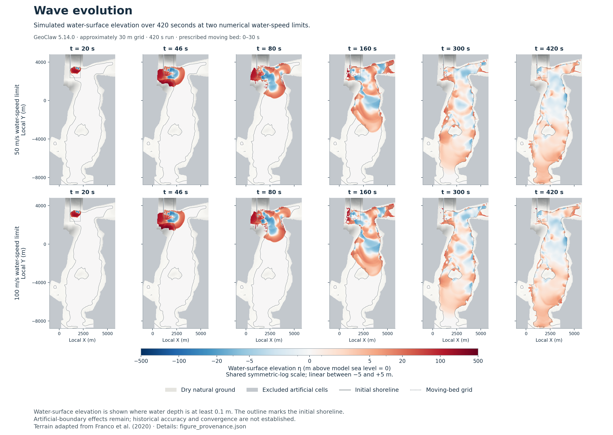
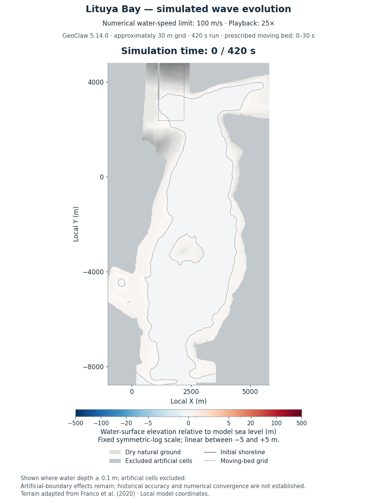
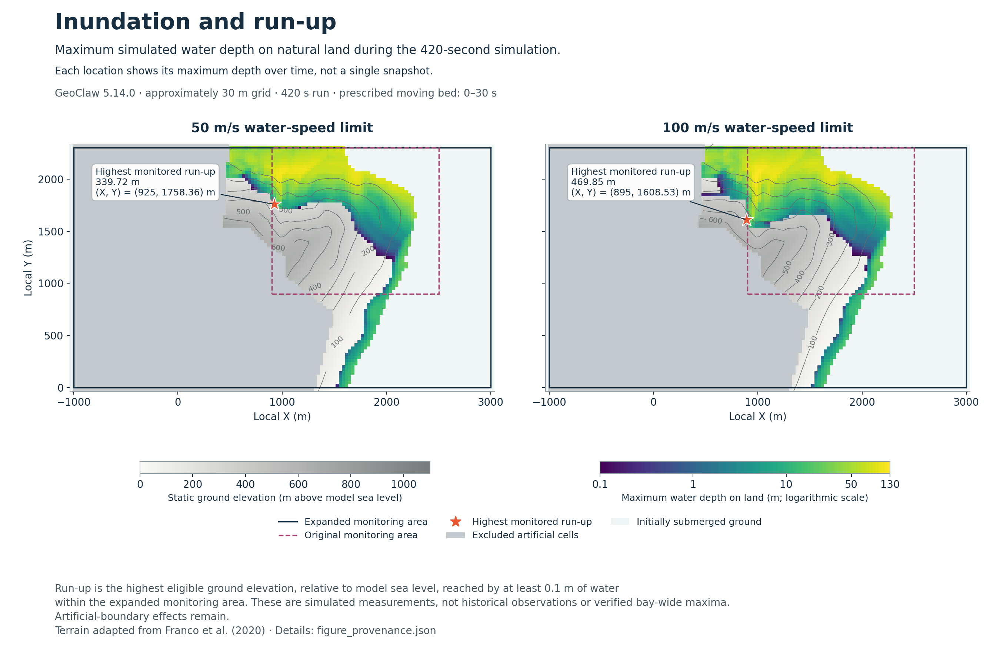
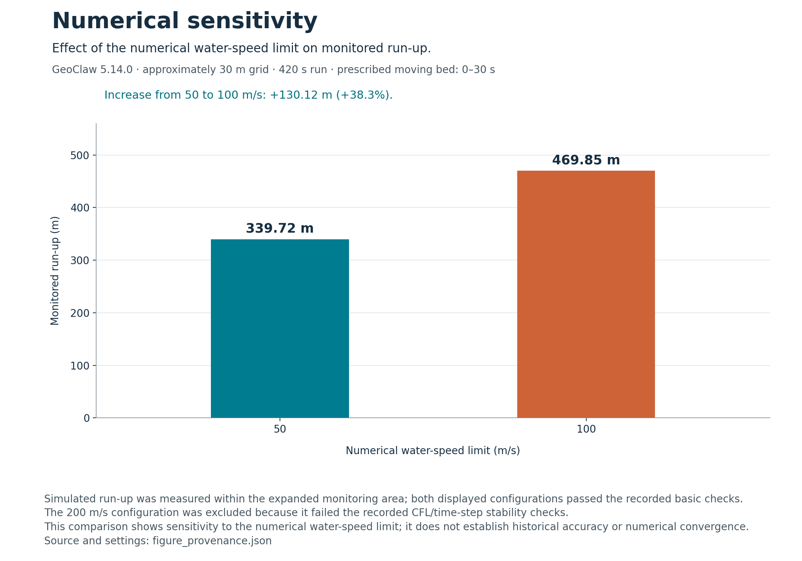

# Lituya Bay simulation

A numerical investigation of the 1958 Lituya Bay megatsunami using GeoClaw, focusing on landslide-generated wave propagation, run-up estimation, and numerical sensitivity.

The repository contains a moving-bed source model, simulation configurations, validation procedures, software tests, and results from a controlled comparison of water-speed limits (50, 100, and 200 m/s).

This preliminary release documents the modeling approach, experimental results, and identified numerical limitations. Further validation and sensitivity analysis are needed to assess historical accuracy and numerical convergence.

## Research objectives

This project investigates the numerical behavior of a simplified model of the 1958 Lituya Bay megatsunami, with particular attention to wave propagation, run-up estimation, and numerical sensitivity.

The study examines how different water-speed limits (50, 100, and 200 m/s) affect simulated run-up and numerical stability. It also considers how measurement criteria and monitoring boundaries influence the interpretation of results.

The objective is to identify the model’s numerical limitations and establish a basis for further validation and refinement.

## Recorded experiment

The completed session is `20261019T041033Z_ff1b17c2`; each case reached 420 s.
The cap is a numerical water-speed limit, not the landslide velocity.

| Water-speed cap (m/s) | Expanded-monitor run-up (m) | Recorded outcome |
| --- | ---: | --- |
| 50 | 339.72425 | Passed basic checks |
| 100 | 469.84918 | Passed basic checks |
| 200 | Unavailable | Failed CFL/time-step checks |

See the [CSV](experiments/2026-10-19-speed-caps/results.csv),
[detailed diagnostics](experiments/2026-10-19-speed-caps/results.json), and
[record description](experiments/2026-10-19-speed-caps/README.md).
The 50 and 100 m/s configurations completed the 420-second simulation period and passed the recorded basic validation checks. Measured run-up increased from 339.72 m to 469.85 m, a difference of approximately 38.3%.

This difference indicates substantial sensitivity to the selected numerical water-speed limit within the tested configurations. The 200 m/s configuration encountered CFL/time-step stability issues and is excluded from the accepted run-up comparison.

Run-up was measured as the maximum eligible ground elevation reached by water at a minimum depth of 0.1 m within the defined monitoring area. These values are specific to that measurement procedure and have not been established as domain-wide maxima.

The results demonstrate numerical sensitivity but do not, by themselves, establish historical accuracy or numerical convergence.

## Recorded-output visualizations

These figures use saved outputs from session `20261019T041033Z_ff1b17c2`, comparing two numerical water-speed limits over 420 seconds. They show simulated results, not historical observations.

**Wave evolution.** Water-surface elevation relative to model sea level at six recorded times: 20, 46, 80, 160, 300 and 420 s. Rows compare the 50 and 100 m/s numerical water-speed limits using a shared symmetric-log colour scale.



**Animated wave evolution.** Simulated water-surface elevation for the 100 m/s numerical water-speed limit, using all 49 saved frames from 0–420 s. Playback is accelerated 25× with timing proportional to the recorded timestamps and no interpolated wave motion. The final frame is held for 1.2 seconds before the 18-second loop repeats.



**Inundation and run-up.** Maximum recorded water depth on eligible natural land within the expanded monitoring area. Each location shows its maximum over time, not one snapshot. Contours show ground elevation; stars mark the highest monitored run-up, not verified bay-wide maxima.



**Numerical sensitivity.** Monitored run-up increases from 339.72 m to 469.85 m between the 50 and 100 m/s configurations. The 200 m/s configuration is excluded because it failed the recorded CFL/time-step checks. This comparison does not establish historical accuracy or numerical convergence.



Map axes use local model coordinates. Masking artificial cells does not remove their influence on the simulation.

The [figure provenance](docs/figures/figure_provenance.json) records full-precision measurements, settings, source hashes and rendering details. The [plotting script](experiments/2026-10-19-speed-caps/plot_figures.py) verifies saved data before generating the figures. Regeneration requires the original local session; raw fields and reference inputs are not included in this repository.

## Software tests

Use Python 3.12 in a virtual environment, from the repository root:

```sh
python3.12 -m venv .venv
source .venv/bin/activate
python -m pip install -r environment/requirements-test.txt
python -m pytest
```

The default tests need no reconstruction data and start no water solver.
Reconstruction-dependent tests are explicitly skipped. See
[testing instructions](docs/TESTING.md) for the full local check and coverage scope.

## Reproducibility and data requirements

Seven external reference files are not redistributed. Their sources, acquisition instructions, and checksum requirements are documented in
[docs/DATA.md](docs/DATA.md).

Reproducing the recorded experiments requires the reference datasets, the specified GeoClaw environment, and the documented preflight checks.

The repository preserves simulation configurations, execution scripts, experimental records, and identifiers needed to trace the recorded results. The Dockerfile provides a build recipe; it does not automatically execute a simulation. A new physical run requires the correct reference inputs and a verified environment.

Software tests can be run independently of the full hydrodynamic simulations.

## Code layout

- `simulation/`: input preparation, measurement, validation, and bounded comparison.
- `geoclaw/`: GeoClaw input writer and Fortran build recipe.
- `tests/`: software tests, synthetic outputs, and solver-input regression fixtures.
- `tools/`: reference resampling, build manifests, and synthetic solver smoke checks.
- `calibration/`, `reporting/`, `workflow.py`: retained earlier workflow modules;
  their source search is outside the bounded experiment and is not a default action.
- `experiments/`: small recorded results and original experiment hashes.

## References

The reconstruction is attributed to [Franco et al. (2020)](https://doi.org/10.5194/nhess-20-2255-2020)
and its [dataset](https://doi.org/10.5281/zenodo.3831448).
The water solver is [GeoClaw / Clawpack](https://github.com/clawpack/clawpack), v5.14.0.
See [THIRD_PARTY.md](THIRD_PARTY.md) and [LICENSE](LICENSE) for component boundaries.

## Research authorship

This project was developed by V. M. Goldsmith. Her contributions include defining the research objectives, developing the experimental approach, selecting and refining numerical comparisons, determining test coverage and validation requirements, evaluating model behavior and results, and establishing the scope and limitations of the study.

AI-assisted tools were used for software implementation, debugging, testing, numerical analysis, and documentation. Research design, methodological decisions, interpretation of results, and publication decisions remained with V. M. Goldsmith.

## Release information

The distribution version is 0.1.0. Older version strings in frozen configurations, launcher image labels, and release/RELEASE_ID identify the earlier workflow or recorded experiment; they are preserved for provenance.
