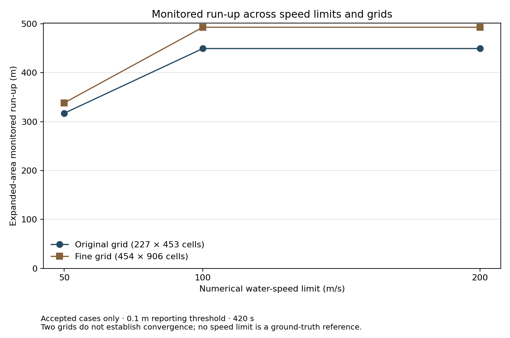

# Speed-limit × grid-resolution experiment

Generated technical analysis report. Produced with AI-assisted implementation, testing, numerical analysis and documentation. It is not an independently written PhD application writing sample. Scientific review is pending; no claim is made that the researcher reviewed every calculation or conclusion.

Generated by [report.py](report.py) from [results.json](results.json), [protocol.json](protocol.json), sealed private execution records and the archived baseline. See the repository [research-authorship and AI-assistance statement](../../README.md#research-authorship).

## Question and declared controls

Does the large run-up sensitivity to the numerical water-speed limit persist under grid refinement, and do the results become less sensitive to further increases in the limit?

Fresh cases share desired CFL 0.5, global dt_max 0.1 s, source-motion dt cap 0.1 s and initial dt 0.02 s. CFL acceptance remains 1.0 with the existing formatted-log tolerance. The policy was declared before launching Stage 1 and is not adjusted to obtain preferred outcomes.

The original grid is 227 × 453 (30 × 29.96688741721854 m); the planned fine grid is 454 × 906 (15 × 14.98344370860927 m), over the identical physical domain. All existing physical-source, water, friction and measurement settings are retained.

## Numerical acceptance and case status

Acceptance requires solver completion and unchanged field, CFL/time-step, monitoring-coverage and input-consistency checks, plus enforcement of the declared global step ceiling. Reaching 420 s alone is insufficient. Failed and unattempted cases contribute no accepted comparison values; the archived failed 200 m/s case remains excluded.

**Complete planned case status**

| Case | Grid | Status | Reason / diagnostic |
| --- | --- | --- | --- |
| original_050 | original | accepted |  |
| original_100 | original | accepted |  |
| original_200 | original | accepted |  |
| fine_050 | fine | accepted |  |
| fine_100 | fine | accepted |  |
| fine_200 | fine | accepted |  |
| archived_cap_200 | original (archived policy) | excluded | Failed CFL/time-step checks despite reaching 420 s. |

## Primary run-up comparisons

Run-up is the highest eligible ground elevation reached by at least 0.1 m of water in the expanded monitoring area, relative to model sea level. Land metrics use per-time-step fgmax monitoring, not the 49 saved visualization frames. These are monitor-specific maxima, not historical observations or established bay-wide maxima.

Differences are the second case minus the first, with percentages relative to the first. Tables round values for display; small nonzero differences use three significant digits so they are not shown as zero. CSVs retain the saved precision. Missing entries mean the comparison cannot be made from two accepted cases; they are not zero results. No after-the-fact “close enough” tolerance is applied.

**Expanded-area monitored run-up (m)**

| Comparison | First (m) | Second (m) | Difference (m) | Difference (%) |
| --- | --- | --- | --- | --- |
| original: 50 → 100 m/s | 317.08 | 449.33 | 132.25 | 41.71 |
| fine: 50 → 100 m/s | 338.24 | 492.84 | 154.60 | 45.71 |
| original: 100 → 200 m/s | 449.33 | 449.33 | 0.00 | 0.00 |
| fine: 100 → 200 m/s | 492.84 | 492.84 | 0.00 | 0.00 |
| 50 m/s: original → fine grid | 317.08 | 338.24 | 21.17 | 6.68 |
| 100 m/s: original → fine grid | 449.33 | 492.84 | 43.51 | 9.68 |
| 200 m/s: original → fine grid | 449.33 | 492.84 | 43.51 | 9.68 |
| 100 m/s: archived → fresh time policy | 469.85 | 449.33 | -20.52 | -4.37 |

## Secondary quantities and limiter diagnostics

The full-precision comparison table also contains original-area run-up, eligible land wetted at any time, maximum land-water depth, and P2/P3/P5 peak water-surface elevations. Wetted area is eligible wet-cell count × actual dx × dy / 1,000,000. Depth maxima are measured above local ground; gauge elevations are relative to model sea level, not peak-to-trough wave heights. Different maxima need not occur together. Equal gauge peaks do not establish identical time series. Percentage differences describe sensitivity; they are not errors relative to reality or statistical uncertainty.

Counts refer to logged b4step2 events; printed event attributes are rounded. They do not represent every limiting operation or unique affected cells, and do not quantify momentum or energy changes. Small or zero logged counts do not by themselves establish accuracy.

**Numerical diagnostics and logged limiter events**

| Case | Status | Maximum printed CFL | Logged events | Events at printed depth ≥10 m |
| --- | --- | --- | --- | --- |
| original_050 | accepted | 0.283 | 15327 | 7963 |
| original_100 | accepted | 0.339 | 4 | 0 |
| original_200 | accepted | 0.467 | 0 | 0 |
| fine_050 | accepted | 0.529 | 57998 | 29919 |
| fine_100 | accepted | 0.618 | 16 | 0 |
| fine_200 | accepted | 0.716 | 0 | 0 |

**original: 50 → 100 m/s — secondary quantities**

| Quantity | Unit | First | Second | Difference | Change (%) |
| --- | --- | --- | --- | --- | --- |
| Original-area monitored run-up | m | 317.08 | 448.97 | 131.89 | 41.60 |
| Eligible land wetted at any time | km² | 1.034757 | 1.159719 | 0.124962 | 12.08 |
| Maximum water depth on eligible land | m | 119.27 | 125.38 | 6.10 | 5.12 |
| P2 peak water-surface elevation | m | 196.04 | 196.04 | 0.00 | 0.00 |
| P3 peak water-surface elevation | m | 73.83 | 77.16 | 3.33 | 4.51 |
| P5 peak water-surface elevation | m | 21.51 | 21.44 | -0.07 | -0.31 |

**fine: 50 → 100 m/s — secondary quantities**

| Quantity | Unit | First | Second | Difference | Change (%) |
| --- | --- | --- | --- | --- | --- |
| Original-area monitored run-up | m | 338.24 | 492.84 | 154.60 | 45.71 |
| Eligible land wetted at any time | km² | 1.077909 | 1.224222 | 0.146313 | 13.57 |
| Maximum water depth on eligible land | m | 127.48 | 125.29 | -2.19 | -1.72 |
| P2 peak water-surface elevation | m | 200.51 | 200.51 | 0.00 | 0.00 |
| P3 peak water-surface elevation | m | 74.05 | 85.55 | 11.50 | 15.53 |
| P5 peak water-surface elevation | m | 23.70 | 23.46 | -0.24 | -1.03 |

**original: 100 → 200 m/s — secondary quantities**

| Quantity | Unit | First | Second | Difference | Change (%) |
| --- | --- | --- | --- | --- | --- |
| Original-area monitored run-up | m | 448.97 | 448.97 | 0.00 | 0.00 |
| Eligible land wetted at any time | km² | 1.159719 | 1.159719 | 0.000000 | 0.00 |
| Maximum water depth on eligible land | m | 125.38 | 125.38 | 0.00 | 0.00 |
| P2 peak water-surface elevation | m | 196.04 | 196.04 | 0.00 | 0.00 |
| P3 peak water-surface elevation | m | 77.16 | 77.16 | 0.00 | 0.00 |
| P5 peak water-surface elevation | m | 21.44 | 21.44 | 0.00 | 0.00 |

**fine: 100 → 200 m/s — secondary quantities**

| Quantity | Unit | First | Second | Difference | Change (%) |
| --- | --- | --- | --- | --- | --- |
| Original-area monitored run-up | m | 492.84 | 492.84 | 0.00 | 0.00 |
| Eligible land wetted at any time | km² | 1.224222 | 1.224222 | 0.000000 | 0.00 |
| Maximum water depth on eligible land | m | 125.29 | 125.27 | -0.02 | -0.01 |
| P2 peak water-surface elevation | m | 200.51 | 200.51 | 0.00 | 0.00 |
| P3 peak water-surface elevation | m | 85.55 | 85.55 | -0.00249 | -0.00291 |
| P5 peak water-surface elevation | m | 23.46 | 23.46 | 0.00230 | 0.01 |

**50 m/s: original → fine grid — secondary quantities**

| Quantity | Unit | First | Second | Difference | Change (%) |
| --- | --- | --- | --- | --- | --- |
| Original-area monitored run-up | m | 317.08 | 338.24 | 21.17 | 6.68 |
| Eligible land wetted at any time | km² | 1.034757 | 1.077909 | 0.043152 | 4.17 |
| Maximum water depth on eligible land | m | 119.27 | 127.48 | 8.20 | 6.88 |
| P2 peak water-surface elevation | m | 196.04 | 200.51 | 4.47 | 2.28 |
| P3 peak water-surface elevation | m | 73.83 | 74.05 | 0.21 | 0.29 |
| P5 peak water-surface elevation | m | 21.51 | 23.70 | 2.19 | 10.20 |

**100 m/s: original → fine grid — secondary quantities**

| Quantity | Unit | First | Second | Difference | Change (%) |
| --- | --- | --- | --- | --- | --- |
| Original-area monitored run-up | m | 448.97 | 492.84 | 43.87 | 9.77 |
| Eligible land wetted at any time | km² | 1.159719 | 1.224222 | 0.064504 | 5.56 |
| Maximum water depth on eligible land | m | 125.38 | 125.29 | -0.09 | -0.07 |
| P2 peak water-surface elevation | m | 196.04 | 200.51 | 4.47 | 2.28 |
| P3 peak water-surface elevation | m | 77.16 | 85.55 | 8.39 | 10.88 |
| P5 peak water-surface elevation | m | 21.44 | 23.46 | 2.02 | 9.40 |

**200 m/s: original → fine grid — secondary quantities**

| Quantity | Unit | First | Second | Difference | Change (%) |
| --- | --- | --- | --- | --- | --- |
| Original-area monitored run-up | m | 448.97 | 492.84 | 43.87 | 9.77 |
| Eligible land wetted at any time | km² | 1.159719 | 1.224222 | 0.064504 | 5.56 |
| Maximum water depth on eligible land | m | 125.38 | 125.27 | -0.11 | -0.08 |
| P2 peak water-surface elevation | m | 196.04 | 200.51 | 4.47 | 2.28 |
| P3 peak water-surface elevation | m | 77.16 | 85.55 | 8.39 | 10.87 |
| P5 peak water-surface elevation | m | 21.44 | 23.46 | 2.02 | 9.41 |

**100 m/s: archived → fresh time policy — secondary quantities**

| Quantity | Unit | First | Second | Difference | Change (%) |
| --- | --- | --- | --- | --- | --- |
| Original-area monitored run-up | m | 464.00 | 448.97 | -15.03 | -3.24 |
| Eligible land wetted at any time | km² | 1.269397 | 1.159719 | -0.109679 | -8.64 |
| Maximum water depth on eligible land | m | 126.88 | 125.38 | -1.50 | -1.18 |
| P2 peak water-surface elevation | m | 196.04 | 196.04 | 0.00 | 0.00 |
| P3 peak water-surface elevation | m | 78.13 | 77.16 | -0.97 | -1.24 |
| P5 peak water-surface elevation | m | 22.34 | 21.44 | -0.90 | -4.03 |

## Refinement and physical setup

The preserved prescribed source has volume 51066493.51727992 m³, travels 1400 m towards negative Y over 30 s, and retains its 0.25 s source-history interval. This is the existing uncalibrated source specification. The compact records include its unchanged physical configuration and sampled-volume range.

Fine-grid preflight passed. Identical terrain.tt3, slide.dtt3, source_arrays.npz and source_history.csv hashes preserve the nodal terrain and source volume/motion history. The native 15 m geometry and four-node (60 m) source padding remain unchanged. Cell averages are reintegrated onto exactly doubled grid dimensions; recombining each four fine cells reproduces its coarse-cell average within the declared numerical preflight tolerance. Monitoring bounds remain fixed in metres. Cell eligibility counts, sampled bed elevations and boundary representations can change through discretization.

## Interpretation and limitations

original: 50 → 100 m/s: 317.08 → 449.33 m; difference +132.25 m (+41.71%).

fine: 50 → 100 m/s: 338.24 → 492.84 m; difference +154.60 m (+45.71%).

original: 100 → 200 m/s: 449.33 → 449.33 m; difference +0.00 m (+0.00%).

fine: 100 → 200 m/s: 492.84 → 492.84 m; difference +0.00 m (+0.00%).

50 m/s: original → fine grid: 317.08 → 338.24 m; difference +21.17 m (+6.68%).

100 m/s: original → fine grid: 449.33 → 492.84 m; difference +43.51 m (+9.68%).

200 m/s: original → fine grid: 449.33 → 492.84 m; difference +43.51 m (+9.68%).

100 m/s: archived → fresh time policy: 469.85 → 449.33 m; difference -20.52 m (-4.37%).

The 50→100 m/s run-up increase persists on both grids.

On the original grid the absolute 100→200 m/s change is smaller than the 50→100 m/s change. This comparison alone does not establish a plateau beyond 200 m/s or numerical convergence.

On the fine grid the absolute 100→200 m/s change is smaller than the 50→100 m/s change. This comparison alone does not establish a plateau beyond 200 m/s or numerical convergence.

Original grid, 50 → 100 m/s — unchanged reported quantities: P2 peak water-surface elevation.

Original grid, 50 → 100 m/s — decreasing reported quantities: P5 peak water-surface elevation.

At original resolution, all seven reported maxima/area metrics are equal for 100 → 200 m/s at the saved precision; this does not establish identical fields or time series.

Fine grid, 50 → 100 m/s — unchanged reported quantities: P2 peak water-surface elevation.

Fine grid, 50 → 100 m/s — decreasing reported quantities: Maximum water depth on eligible land, P5 peak water-surface elevation.

Fine grid, 100 → 200 m/s — unchanged reported quantities: Expanded monitored run-up, Original-area monitored run-up, Eligible land wetted at any time, P2 peak water-surface elevation.

Fine grid, 100 → 200 m/s — decreasing reported quantities: Maximum water depth on eligible land, P3 peak water-surface elevation.

Compare fresh 100 m/s against archived 100 m/s separately: this isolates the changed time-stepping policy at the original grid, and must be reported even when the difference is large. The within-grid comparisons use identical policies and measurement definitions.

Two grids are not proof of convergence. The 200 m/s setting is not ground truth, and no accepted cap has been established as physically correct or optimal. Historical accuracy is not established. Artificial boundaries can influence the water even when their cells are excluded from measurement. This is a bounded preliminary numerical experiment, not source calibration.

HTML visual review remains pending because browser policy blocked local-file inspection. Structural/table-data checks are recorded separately. See verification.json and README.md for commands, actual test counts and prerequisites.

[Full-precision results](results.csv) · [Comparisons](comparisons.csv) · [Provenance](provenance.json)
